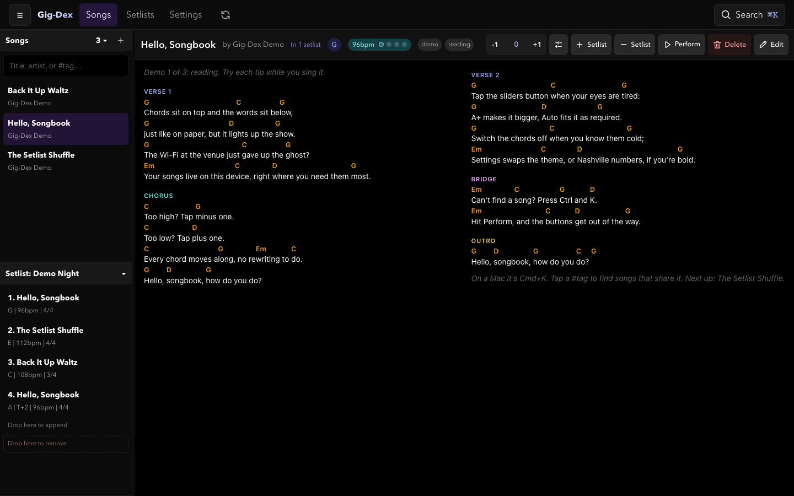
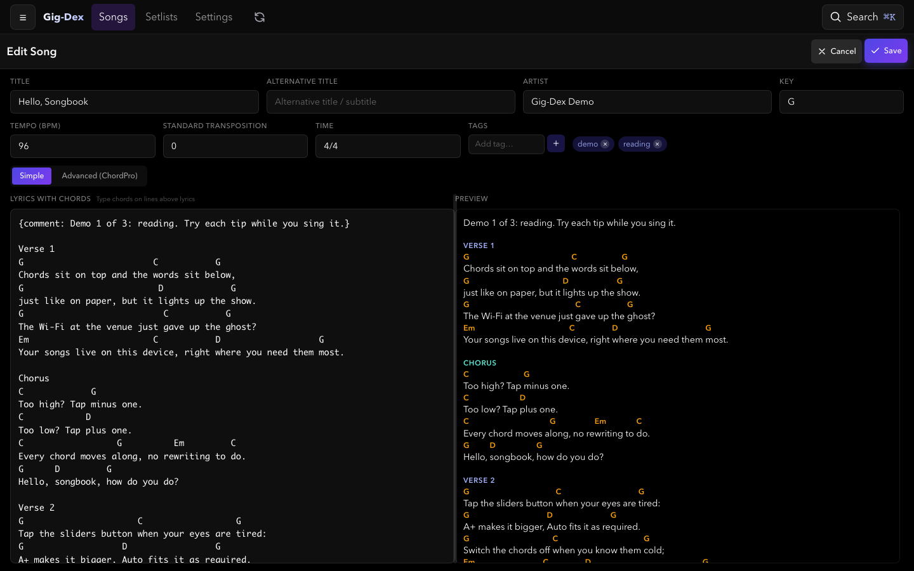
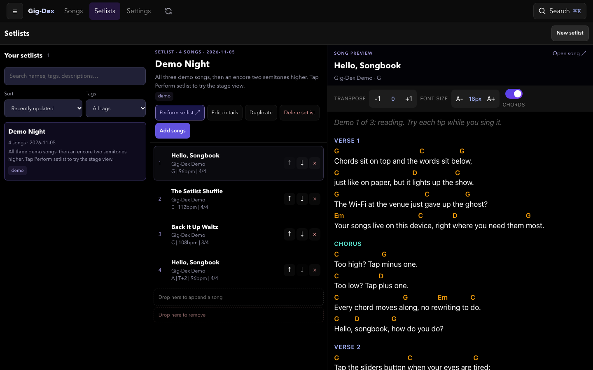

# Gig-Dex 🎸

**Your digital songbook and setlist manager for the stage, the rehearsal room, and the couch.**

Gig-Dex keeps all your songs, chords, and setlists in one place, readable on phone, tablet, or laptop, even when the venue Wi-Fi gives up.

👉 **Try it:** https://fannon.github.io/gig-dex/

> [!NOTE]
> Gig-Dex is a hobby side-project, built mostly by "vibe-coding". It works well for daily use, but expect rapid changes and the occasional rough edge.

---

## For musicians

### What can I do with it?

- **Collect your repertoire:** keep lyrics + chords together, neatly aligned.
- **Play in any key:** transpose any song instantly without rewriting anything, and give each song a standard key offset.
- **Build setlists:** put songs in gig order, including repeats, notes, and a separate key for every entry.
- **Perform distraction-free:** big, auto-fitting text, page-by-page or scrolling reading, simple Previous / Next navigation, optional visual beat pulse.
- **Read your way:** choose chord names, Nashville numbers, or Roman numerals; set a minimum font size and column limit in *Settings → Appearance → Song reading*.
- **Find songs fast:** search by title, artist, tag, or setlist with `Ctrl+K` (`Cmd+K` on Mac).
- **Works offline:** once loaded, your library is on your device. No account, no subscription, no cloud required.

It understands the popular [ChordPro](https://www.chordpro.org/) format (`[Am]Hello [G]world`), so you can paste or import songs from many other tools. The simple editor also accepts the typical guitar-chords style with chord lines above the lyrics (like [Ultimate-Guitar chord sheets](https://tabs.ultimate-guitar.com/)) and converts it automatically. Editing happens in monospace so chords stay aligned. An explicit one-click import for that format is planned.

<table>
  <tr valign="top">
    <td><a href="docs/screenshots/tutorial-song.png"></a></td>
    <td><a href="docs/screenshots/edit-song.png"></a></td>
    <td><a href="docs/screenshots/demo-setlist.png"></a></td>
  </tr>
  <tr valign="middle" align="center">
    <td><em>A demo song. Tap "Add demo songs" for a short sung tour.</em></td>
    <td><em>Simple editor with live preview</em></td>
    <td><em>Demo Night setlist with song preview</em></td>
  </tr>
</table>

### Get started in 3 steps (no account needed)

1. **Open the app** in your browser (link above). New here? Tap **Add demo songs**: three short songs (a pop tune, a blues and a waltz) walk you through reading, setlists, editing and backups, plus a *Demo Night* setlist to try **Perform setlist**. Delete them whenever you like.
2. **Add songs:** go to *Settings → Library → Import ChordPro songs* and select a few `.cho` / `.pro` / `.txt` files, or create a new song and paste chords-over-words text.
3. **Make a setlist:** go to *Setlists → New setlist*, use **Add songs**, then hit **Perform setlist**.

Press **Save** after editing a song or setlist details. Setlist song order and additions are saved automatically on that device. To delete a song, open it, tap **Edit**, then **Delete song**; **Undo** brings it back, including its places in your setlists.

The song editor accepts simple chords-over-words text (chords on the line above the lyrics) and standard ChordPro. *Settings → Appearance* chooses the theme and chord notation: standard, German (`H` for B natural, `B` for B flat), Nashville numbers or Roman numerals. Stored chords never change.

### Keep your songs safe: backup & sync

Your library lives **on your device**, in your browser: private and available offline. Back it up, and sync it if you use several devices:

- **Backup file** (everyone): *Settings → Library → Export library* downloads one `.json` file with everything. Restore it under *Restore backup*. Do this before gigs and updates. → [Backup and import](docs/backup-and-import.md)
- **Dropbox** (desktop and mobile, easiest direct sync): register your own Dropbox app once, then connect under *Settings → Sync*. → [Dropbox setup](docs/dropbox-sync.md)
- **Local folder** (Chrome/Edge on desktop): pick a folder inside your OneDrive, Google Drive, Dropbox or Nextcloud desktop folder; your existing sync app carries the files. No registration needed. → [Local folder sync](docs/local-folder-sync.md)
- **Google Drive / OneDrive direct** (advanced): needs your own OAuth app registration. → [Sync overview](docs/sync.md#direct-google-drive-and-onedrive)

Connected providers sync when Gig-Dex opens and after you save; **Sync now** checks immediately. The navbar sync icon spins while syncing and turns red when something needs attention. If two devices change the same song, Gig-Dex keeps both versions for you to review. Details, conflicts and troubleshooting: [Sync and multiple devices](docs/sync.md).

### Install it like an app (Android / desktop)

Open the live URL in Chrome or Edge and use the browser's **Install app** or **Add to home screen** action. It then opens as an app, works offline, and can keep the screen awake during a gig. When a new version is ready, an **App update ready** indicator appears in the navbar; updates never interrupt a performance or unsaved edits. → [Offline use and updates](docs/offline-and-updates.md), [Performance mode](docs/performance-mode.md)

Before an important gig, open your setlist once while online, then try airplane mode and close/reopen the app. You'll see exactly what the stage will see.

---

## For developers

Gig-Dex is a React + Vite + TypeScript PWA. Storage is IndexedDB (via `idb`), sync is file-based revision exchange (local folder, Google Drive, OneDrive, Dropbox).

### Quickstart

Dependencies are locked with `bun.lock`. Install with Bun; the task scripts also run with npm:

```bash
bun install --frozen-lockfile
npm run dev        # start dev server
npm run validate   # lint + typecheck + unit tests; run after every change
npm run verify     # validate + build + E2E tests; run before declaring "done"
```

More commands:

- `npm run test` / `npm run test:e2e`: Vitest / Playwright
- `npm run lint:fix` / `npm run format`: Biome
- `npm run screenshots -- --input tmp/import --output reports/song-layout`: song layout audit (see script help)
- `npm run screenshots:readme`: regenerate the README screenshots from the demo songs

### Docs

- Using Gig-Dex: [setlists](docs/setlists.md), [performance mode](docs/performance-mode.md), [search and reading settings](docs/search-and-reading-settings.md), [backup and import](docs/backup-and-import.md), [offline use and updates](docs/offline-and-updates.md)
- Sync: [overview](docs/sync.md), [Dropbox setup](docs/dropbox-sync.md), [local folder and your own Client IDs](docs/local-folder-sync.md), [sync folder format](docs/sync-format.md)
- Development: [architecture notes](docs/architecture.md), [AGENTS.md](AGENTS.md) (verification workflow)

---

*Made with ☕ and "vibes".*
